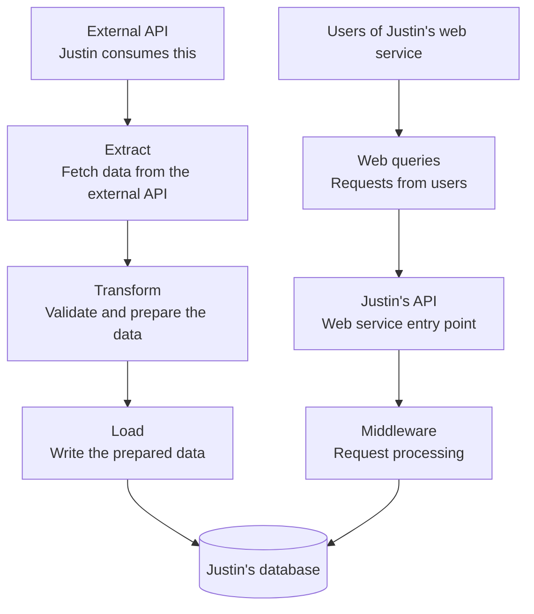

# Web-Based ETL System Design

A practical guide to designing a web service that brings data in from an external API, stores it, and makes it useful to people through its own API.

This starts with Justin's first web service and a simple question: how can we do what we're doing better? As we work through the system, we'll add design notes at each layer, explain the problems they solve, and keep the examples useful to anyone building something similar.

## The starting picture

Two paths meet at one database. On the left, an ETL pipeline brings data into the system. On the right, users query Justin's web service.

**Left: bringing data in.** ETL means *Extract, Transform, Load*: fetch data from a source, prepare it for our needs, and write it to our database.

**Right: serving users.** Users send web requests to Justin's API. The service processes those requests and queries the stored data. Results travel back to the users; the diagram shows the downward request path to keep the starting picture simple.

The API and middleware boxes show responsibilities. In application code, middleware commonly runs before an endpoint handler and may also process the response on its way out.

This is a starting sketch. The framework, database engine, hosting, ingestion schedule, and behavior of the external API are still open. We'll fill those in as we learn what the system needs.

## First design notes

- **Give ingestion and user requests separate responsibilities.** The ETL path prepares stored data; the request path serves it. Keeping those responsibilities clear makes each easier to understand and change. They can still live in the same codebase and deployment.
- **Validate data at both boundaries.** Check incoming source data before storing it, and check user input before using it in a query. We'll define the rules once we know the data and the requests.
- **Make the database's job explicit.** Decide what each record represents, how it is identified, and which rules the database should enforce. Both paths need to agree on those meanings.
- **Define how fresh the data needs to be.** Users querying stored data see what has been ingested so far. The acceptable delay will help us choose when ingestion runs and how to show its status.

## What we'll fill in next

- What data does the external API provide, and what limits does it impose?
- What does Justin do to that data before storing it?
- What questions do users ask, and who is allowed to see which data?
- What happens when an import or a user request fails?

We'll add detail to the diagram and notes as those answers arrive, with the reason for each design decision alongside it.

## License

[MIT](LICENSE) — use, adapt, and share this guide.
