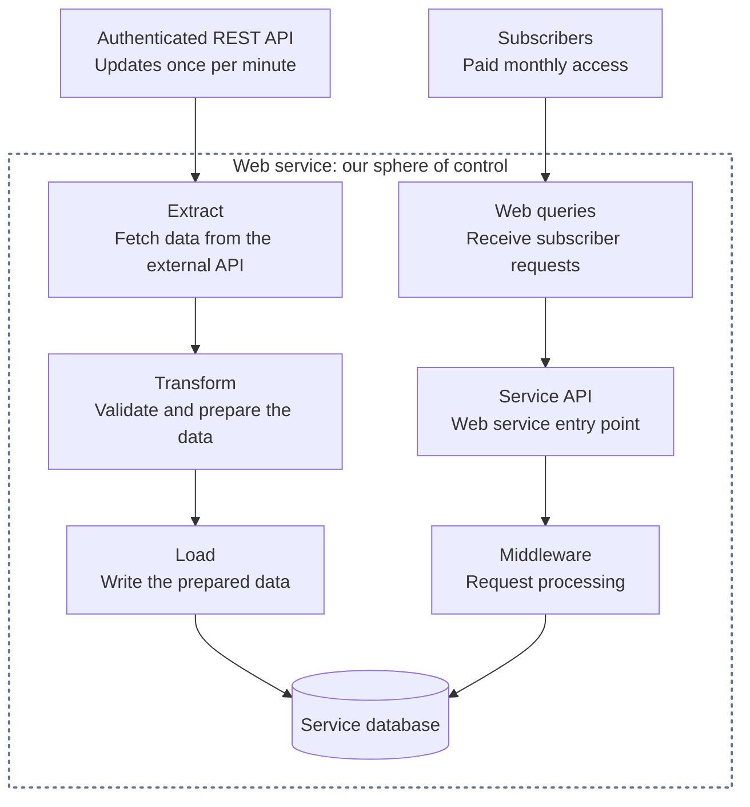

# Web-Based ETL System Design

A practical guide to turning external API data into a service people pay a monthly subscription to use.

## Table of contents

- [1. Quick Problem Description](#1-quick-problem-description)
- [2. Observability/Monitoring/Alerting](#2-observabilitymonitoringalerting)
- [3. System Components](#3-system-components)
  - [3.1 Data Ingest](#31-data-ingest)
    - [3.1.1 Resilient Reader Fleet](#311-resilient-reader-fleet)
    - [3.1.2 Resilient Message Queue](#312-resilient-message-queue)
    - [3.1.3 Resilient DB Writer](#313-resilient-db-writer)
    - [3.1.4 Monitoring/Alerting](#314-monitoringalerting)
- [License](#license)

## 1. Quick Problem Description

An authenticated REST API publishes data once per minute. Our service fetches it, adds value, and makes it available to paying subscribers. The ETL pipeline **extracts** (fetches), **transforms** (prepares), and **loads** (stores) the data; subscriber requests use our API to access the results.

The dotted box marks our sphere of control; the provider and subscribers are outside it. Arrows show the data and request paths. The API and middleware boxes show responsibilities; middleware typically runs before an endpoint handler and may also process its response.

## 2. Observability/Monitoring/Alerting

Design [monitoring and alerting](https://sre.google/sre-book/monitoring-distributed-systems/) from the start. The owner should learn about problems **no later than customers do**. At every layer, ask what can break, how we'll detect it, what the system should do, and when to notify the owner. A dashboard alone won't wake anyone up. Every component in section 3 closes with **Monitoring/Alerting**, covering what to watch and when to act as we design that component.

**Silence can be its own problem.** Send recurring test alerts through production detection, routing, and delivery; record arrival at the destination before filtering them out of routine human notifications. If that heartbeat stops, an independent watchdog must raise its **own alert**, potentially **out of band (OOB)** through a channel that doesn't depend on the primary alerting system. Occasionally test actual owner notifications too.

## 3. System Components

### 3.1 Data Ingest

Move source updates through readers and a message queue into the database.

#### 3.1.1 Resilient Reader Fleet

Fetch updates from the external API, with coordinated work and recovery when a reader fails.

#### 3.1.2 Resilient Message Queue

Buffer fetched updates and provide a reliable handoff between readers and database writers.

#### 3.1.3 Resilient DB Writer

Consume queued updates, prepare them for storage, and write them safely even when a message is retried.

#### 3.1.4 Monitoring/Alerting

**Watch the source:** request failures, response times, and data freshness based on the provider's publication timestamp and expected schedule. A `200 OK` can still carry stale data; without reliable source metadata, freshness is unknown. A timeout alone doesn't locate the fault; an independent check can help narrow it down.

**Watch your ingest pipeline:** missed reader runs, missing heartbeats, stalled progress, queue backlog and oldest-message age, writer failures, and time since the last complete ingest. Fresh source data with stale local data points toward our readers, queue, or database-writing path. Run alerting outside the application's host, notify the owner before freshness or coverage becomes unacceptable to subscribers, and test that alerts arrive.

## License

[MIT](LICENSE) — use, adapt, and share this guide.
