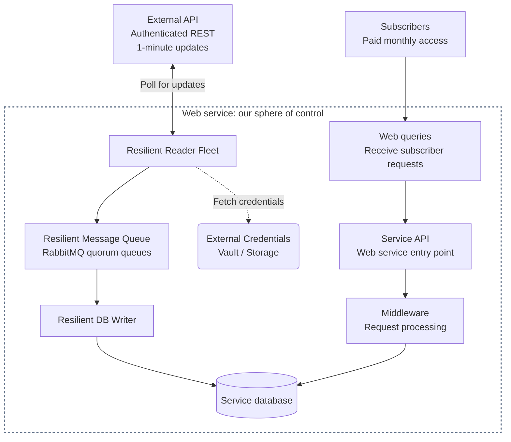

# Web-Based ETL System Design

A practical guide to turning external API data into a service people pay a monthly subscription to use.

## Table of contents

- [1. Quick Problem Description](#1-quick-problem-description)
- [2. Observability/Monitoring/Alerting](#2-observabilitymonitoringalerting)
- [3. System Components](#3-system-components)
  - [3.1 Data Ingest](#31-data-ingest)
    - [3.1.1 External Credentials Vault/Storage](#311-external-credentials-vaultstorage)
    - [3.1.2 Resilient Reader Fleet](#312-resilient-reader-fleet)
    - [3.1.3 Resilient Message Queue](#313-resilient-message-queue)
    - [3.1.4 Resilient DB Writer](#314-resilient-db-writer)
    - [3.1.5 Monitoring/Alerting](#315-monitoringalerting)
  - [3.2 Database](#32-database)
    - [3.2.1 Primary DB and Failover Standby](#321-primary-db-and-failover-standby)
    - [3.2.2 Read Replicas](#322-read-replicas)
    - [3.2.3 Backup and Restore](#323-backup-and-restore)
    - [3.2.4 Monitoring/Alerting](#324-monitoringalerting)
- [License](#license)

## 1. Quick Problem Description

An authenticated REST API publishes data once per minute. Our service fetches it, adds value, and makes it available to paying subscribers. The ETL pipeline **extracts** (fetches), **transforms** (prepares), and **loads** (stores) the data; subscriber requests use our API to access the results.

The dotted box marks our sphere of control; the provider and subscribers are outside it. The reader fleet fetches credentials from the vault through the dotted side connection. Its bidirectional source-API link shows reader-initiated polling and responses; updates flow through the queue and DB writer into storage. The API and middleware boxes show responsibilities; middleware typically runs before an endpoint handler and may also process its response.

## 2. Observability/Monitoring/Alerting

Design [monitoring and alerting](https://sre.google/sre-book/monitoring-distributed-systems/) from the start. The owner should learn about problems **no later than customers do**. At every layer, ask what can break, how we'll detect it, what the system should do, and when to notify the owner. A dashboard alone won't wake anyone up. Every component in section 3 closes with **Monitoring/Alerting**, covering what to watch and when to act as we design that component.

**Silence can be its own problem.** Send recurring test alerts through production detection, routing, and delivery; record arrival at the destination before filtering them out of routine human notifications. If that heartbeat stops, an independent watchdog must raise its **own alert**, potentially **out of band (OOB)** through a channel that doesn't depend on the primary alerting system. Occasionally test actual owner notifications too.

## 3. System Components

### 3.1 Data Ingest

Move source updates through readers and a message queue into the database.

#### 3.1.1 External Credentials Vault/Storage

A prototype may keep credentials in code or plaintext `.env`/deployment configs. A stolen key or bearer token may impersonate the customer within its permissions. Use an access-controlled [secrets store](https://cheatsheetseries.owasp.org/cheatsheets/Secrets_Management_Cheat_Sheet.html), limit reader access, and plan provider-supported rotation and revocation. **Startup-injected environment variables normally require reader restarts to pick up credential changes; fetching the current secret from the store for each collection cycle can pick up rotations without restarting.** Any caching needs an explicit refresh policy. A hosted service can improve availability and reduce vault maintenance; DigitalOcean documents a [Secrets Manager CLI](https://docs.digitalocean.com/reference/doctl/reference/secrets/) and [API](https://docs.digitalocean.com/reference/api/reference/security/) for readers on Droplets. Protect store-access credentials, check regional resilience, and keep secrets out of code, images, browser bundles, and logs.

#### 3.1.2 Resilient Reader Fleet

The aim is to design a system that can survive failures without customers ever noticing an interruption in data flow. Each reader independently polls the source API and publishes its copy of each fetched update to the queue. Spread readers across [independent failure domains](https://docs.aws.amazon.com/whitepapers/latest/aws-fault-isolation-boundaries/availability-zones.html)—preferably separate availability zones (AZs), or separate regions when regional outages are in scope. Healthy readers can keep collecting while a failed host or network link recovers. Budget redundant calls against the provider's shared rate limits, and handle duplicate or out-of-order updates safely downstream.

#### 3.1.3 Resilient Message Queue

The aim is for every reader's copy to reach a DB writer, with redundant copies protecting an observation if one is lost before queue acceptance. **[RabbitMQ](https://www.rabbitmq.com/docs/download) with [quorum queues](https://www.rabbitmq.com/docs/quorum-queues) — RECOMMENDED** is a well-documented, Docker-friendly fit for this well-solved work-queue problem. Use a [three-node cluster](https://www.rabbitmq.com/docs/clustering) across separate hosts and, where possible, three independent failure domains, with three replicas per queue and persistent storage per node. Check routing and require [publisher confirms](https://www.rabbitmq.com/docs/confirms); a quorum queue confirms after majority replication. If a node dies before confirmation, acceptance is uncertain: reconnect and retry unconfirmed publishes, expecting duplicates. Writers acknowledge only after database commit. Test failover; consider [Kafka](https://kafka.apache.org/intro/) when retained event history and independent replay become requirements.

#### 3.1.4 Resilient DB Writer

The goal is for every queued copy to be processed successfully, even when another writer has already stored the same observation. **Database uniqueness constraints are required** on a stable source-observation key, so the first committed copy wins. Use an atomic [`INSERT … ON CONFLICT … DO NOTHING`](https://www.postgresql.org/docs/current/sql-insert.html) targeted at that key; an expected duplicate is a successful no-op, not a reason to crash or page the owner. Commit the database transaction before acknowledging RabbitMQ. Other database errors still need normal handling. The [database section](#32-database) owns the observation key and its constraints.

#### 3.1.5 Monitoring/Alerting

**Credentials store:** Watch failed or slow secret retrievals, denied or unexpected access, credential expiry where applicable, and failed rotations. Distinguish vault failures from upstream authentication errors; a healthy reader can still be locked out. Alert on suspected misuse and access failures that threaten ingestion, using audit metadata without logging secret values.

**Reader fleet:** Watch missed polls, missing heartbeats, request failures, response times, and source-data age against the provider's expected schedule. A `200 OK` can carry stale data; without reliable source metadata, freshness is unknown. Compare upstream responses with reader progress to separate source trouble from our own failures. A timeout alone doesn't locate the fault; an independent check can help.

**Message queue:** Watch availability, node and replica health, unconfirmed publishes, publish-confirm latency, publish/consume errors, backlog size, and the age of the oldest waiting message. Alert when a node or replica failure reduces resilience, even if messages are still flowing. A growing backlog can mean writers are blocked or too slow, even when the queue is healthy. Alert before queue delays consume the subscribers' freshness budget.

**DB writer:** Watch failed or slow writes, repeated retries, and time since the last successful database update. Count expected duplicates separately from failed writes, and keep freshness tied to source observation time. Fresh queued data with stalled writes points toward the writer or database. Check that fresh, complete data actually reaches subscribers; a successful write alone doesn't prove that. Run monitoring outside the application's host, notify the owner before freshness or coverage becomes unacceptable, and test that alerts arrive.

### 3.2 Database

The database supports both ingestion and subscriber queries. Our example uses [DigitalOcean Managed PostgreSQL](https://docs.digitalocean.com/products/databases/postgresql/) with TimescaleDB enabled, a useful foundation for observations organized around assets and time. Managed hosting lets the provider operate the infrastructure and backup facilities while we focus on schema, access permissions, queries, and retention. We still choose the availability configuration and test recovery; DigitalOcean documents this [shared responsibility](https://docs.digitalocean.com/products/databases/postgresql/concepts/responsibility-model/). Under its [plan rollout](https://docs.digitalocean.com/release-notes/upcoming/dbaas-plan-changes/), eligible existing Standard clusters retain both standby and read-only nodes; new Standard clusters subject to the restrictions support neither. Plan for Advanced when those features are needed, and verify [TimescaleDB extension compatibility](https://docs.digitalocean.com/products/databases/postgresql/details/supported-extensions/) before migration.

Define the stable source-observation key and enforce first-committed-copy-wins here, so independent writers share the same storage contract. For [TimescaleDB hypertables](https://www.tigerdata.com/docs/build/performance-optimization/hypertables-and-unique-indexes), unique keys must include every partitioning column, including time; use a source timestamp that stays the same across repeated deliveries of that observation.

#### 3.2.1 Primary DB and Failover Standby

**Start with a single Standard instance — RECOMMENDED.** Let ingestion and subscriber queries share it while measured performance meets their targets, with managed backups and tested restores. When the acceptable recovery window calls for it, plan a [failover standby](https://docs.digitalocean.com/products/databases/postgresql/how-to/add-standby-nodes/) ready to take over after primary failure; availability needs can justify this even at low load. Add one to an eligible existing cluster or plan a migration to a compatible HA offering. DigitalOcean describes eligible Standard deployments as offering [failover in minutes](https://docs.digitalocean.com/products/databases/postgresql/how-to/create/); test how long application reads and writes actually take to recover. A standby supplies failover capacity, while a dedicated read replica supplies query capacity.

#### 3.2.2 Read Replicas

On a plan that supports it, add a [read replica](https://docs.digitalocean.com/products/databases/postgresql/how-to/add-read-only-nodes/) when sustained query latency shows subscriber reads competing with ingestion for CPU or I/O, after checking queries, indexes, and connection pooling. This gives subscriber queries their own capacity. If writes are the bottleneck, optimize them or resize the primary; a replica must still replay those writes. Include replication lag in the subscriber freshness budget, and define how the API behaves when replicas are unavailable or too stale.

#### 3.2.3 Backup and Restore

**Backups and tested restores are table stakes with paying customers.** DigitalOcean provides [daily backups and point-in-time recovery](https://docs.digitalocean.com/products/databases/postgresql/details/features/) over a seven-day window. Define acceptable data loss and recovery time, then regularly [restore to a separate cluster](https://docs.digitalocean.com/products/databases/postgresql/how-to/restore-from-backups/), verify TimescaleDB data and representative queries, and rehearse application cutover. Standbys improve availability; backups recover from unwanted changes that replicas also copy. Plan retention to meet business needs: deleting a DigitalOcean cluster also deletes its managed backups.

#### 3.2.4 Monitoring/Alerting

**Primary and standby:** Combine [DigitalOcean's database metrics](https://docs.digitalocean.com/products/databases/postgresql/how-to/monitor-databases/) with application timings. Watch p95 subscriber-query and write-commit latency, sustained CPU or disk-I/O saturation, memory pressure, connection-pool waits, lock waits, failed transactions, storage headroom, and queue age. Correlate query slowdowns with ingestion activity, and alert on sustained trends approaching latency or freshness limits. Track standby readiness and measured application recovery time after failover; use an independent database-access check alongside provider health signals.

**Read replicas:** Once added, watch replication lag, query latency, and resource headroom on each replica. Verify source-data age and coverage through the subscriber API, so fast queries returning old data are visible. Alert before lag consumes the freshness budget or a replica failure overloads the remaining read capacity.

**Backup and restore:** Track backup failures, the available recovery window, and the date and outcome of the latest restore test. Verify restored data and application access, and compare measured data loss and recovery time with the agreed limits. Alert when required recovery points are missing or restore tests fail.

## License

[MIT](LICENSE) — use, adapt, and share this guide.
