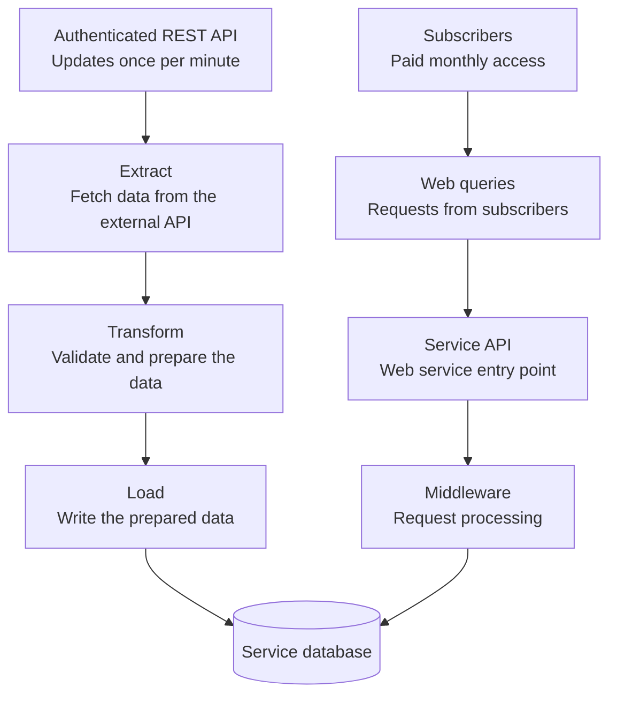

# Web-Based ETL System Design

A practical guide for anyone building a web service that consumes data from an external API, adds value to it, and offers access through a paid monthly subscription.

The goal is to turn source data into useful information or tools that people will pay to keep using. As we work through the system, we'll add design notes at each layer and explain the problems they solve, with practical examples for developers building their first service.

## The starting picture

Two paths meet at one database. On the left, an ETL pipeline brings data into the system. On the right, subscribers query the web service to access its added value.

**Left: bringing data in.** ETL means *Extract, Transform, Load*: fetch data from a source, prepare it for our needs, and write it to our database.

**Right: serving subscribers.** Subscribers send web requests to the service API. The service processes those requests and queries the stored data to deliver useful results. Results travel back to the subscribers; the diagram shows the downward request path to keep the starting picture simple.

The API and middleware boxes show responsibilities. In application code, middleware commonly runs before an endpoint handler and may also process the response on its way out.

This is a starting sketch. The source uses an authenticated REST API and publishes updates once per minute. Its detailed behavior and limits, along with the service's framework, database engine, hosting, and ingestion schedule, still need to be established.

## First design notes

- **Give ingestion and user requests separate responsibilities.** The ETL path prepares stored data; the request path serves it. Keeping those responsibilities clear makes each easier to understand and change. They can still live in the same codebase and deployment.
- **Validate data at both boundaries.** Check incoming source data before storing it, and check user input before using it in a query. We'll define the rules once we know the data and the requests.
- **Make the database's job explicit.** Decide what each record represents, how it is identified, and which rules the database should enforce. Both paths need to agree on those meanings.
- **Define how fresh the data needs to be.** Users querying stored data see what has been ingested so far. The acceptable delay will help us choose when ingestion runs and how to show its status.

## Extract: collecting data that updates every minute

For this example, the external provider publishes updates once per minute. That cadence is a design input, not a guarantee that our subscribers will always see data less than a minute old. We still need to confirm the provider's publication timing, coverage, and availability guarantees.

### Start with an ingestion worker

For a source that expects polling, start with one scheduled server-side worker that collects data independently of subscriber requests. All subscribers can then use the ingested data without each triggering another upstream fetch. The worker can initially share a deployment with the service; keep its collection logic separate so it can move to its own deployment when needed.

One collection cycle may require requests for many assets or multiple pages. A source that updates once per minute does **not** necessarily require just one HTTP request per minute. Work out the total request budget, including retries and authentication, against the provider's limits before choosing a polling schedule.

### Keep source credentials on the server

The worker authenticates to the external provider. Subscribers authenticate to our service; they should never need the provider's credentials.

Keep source credentials out of browser code, the repository, and logs. Supply them through protected server-side configuration or a secrets manager. Establish how credentials expire or rotate and how the worker recovers access, using the provider's documented authentication flow. See [OWASP's secrets management guidance](https://cheatsheetseries.owasp.org/cheatsheets/Secrets_Management_Cheat_Sheet.html).

### Plan for slow requests and failed cycles

- **Set time limits.** Bound individual requests and the whole collection cycle so a stalled source cannot leave a run hanging indefinitely.
- **Control overlapping runs.** If the next scheduled tick arrives while collection is still running, explicitly defer or skip it and record that outcome. Start with one active owner of the schedule; adding service replicas must not accidentally multiply upstream collection.
- **Retry temporary failures within a budget.** Use delayed retries with backoff and a small random variation in timing (jitter). Limit attempts and total elapsed time, and only retry operations that are safe to repeat. Avoid layering independent retry loops. See Microsoft's [Retry pattern](https://learn.microsoft.com/en-us/azure/architecture/patterns/retry).
- **Respect throttling.** An HTTP `429 Too Many Requests` response signals rate limiting and may include `Retry-After`. Honor that delay when supplied; if it exceeds the run's time budget, defer the work. Apply that cooldown to later scheduled cycles too, so the next tick cannot fetch too early. If the header is absent, use the provider's documented policy and bounded backoff. See [RFC 6585, section 4](https://www.rfc-editor.org/rfc/rfc6585#section-4).
- **Handle access failures separately.** An expired credential or denied permission needs the documented renewal flow or operator attention. Repeating the same unauthorized request every few seconds will not fix access.

### Measure freshness through the whole pipeline

Track the source update and our own timestamps, using UTC consistently for times:

| Recorded detail | What it tells us |
| --- | --- |
| Source timestamp or version, when provided | Which source update the data represents. A version identifies an update but may not establish its age. |
| Fetch completion time | When our worker received the data. This alone does not prove that the source data is fresh. |
| Availability time | When that update finished processing and became available to subscriber queries. |

Polling every 60 seconds can add almost another minute of waiting after a source update, even before network, transformation, and database delays. Choose a subscriber-facing freshness target first, then choose and measure a collection schedule that can meet it within the source's limits. A successful HTTP response is not enough: track which expected assets or pages were collected and which updates actually became available.

Define what subscribers see when updates are late or incomplete, and when an operator should be alerted. If the provider supplies no usable source timestamp, report the last successful fetch time as such; do not present it as the age of the underlying data.

### Find out whether missed updates can be recovered

Does the endpoint expose only the latest snapshot, or can it return historical updates or changes since a cursor? If it only returns the latest snapshot, a later successful fetch may leave gaps from an outage. Record those gaps rather than claiming retries recovered every missed minute.

When we reach the load stage, we'll define how repeated or out-of-order fetches are handled safely and when a collection checkpoint may advance. Extraction retries and restarts make those downstream rules necessary.

## What we'll fill in next

- How many assets must we collect, and does one request return one asset or a batch?
- What are the provider's request limits, authentication rules, publication timing, and history or replay capabilities?
- How fresh must subscriber-visible data be, and what happens when that target is missed?
- What does the service do to that data before storing it?
- What value does the service add that makes a monthly subscription worthwhile?
- What questions do users ask, and who is allowed to see which data?
- What happens when an import or a user request fails?

We'll add detail to the diagram and notes as those answers arrive, with the reason for each design decision alongside it.

## License

[MIT](LICENSE) — use, adapt, and share this guide.
