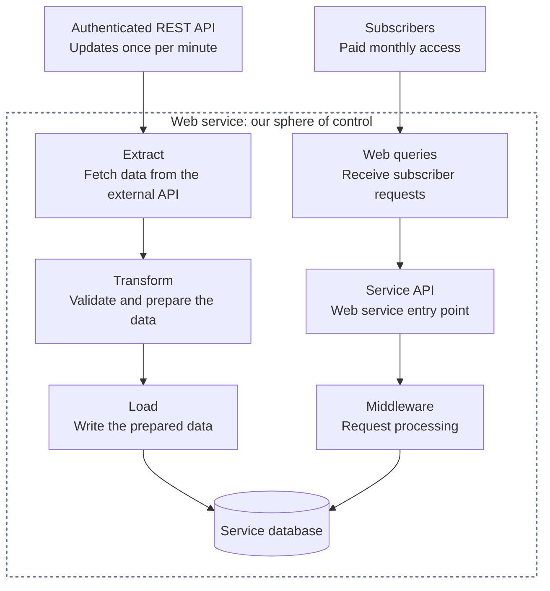

# Web-Based ETL System Design

A practical guide to turning external API data into a service people pay a monthly subscription to use.

## Table of contents

- [1. Quick Problem Description](#1-quick-problem-description)
- [2. Observability/Monitoring/Alerting](#2-observabilitymonitoringalerting)
  - [2.1 Monitoring/Alerting for Data Ingest](#21-monitoringalerting-for-data-ingest)
- [License](#license)

## 1. Quick Problem Description

An authenticated REST API publishes data once per minute. Our service fetches it, adds value, and makes it available to paying subscribers. The ETL pipeline **extracts** (fetches), **transforms** (prepares), and **loads** (stores) the data; subscriber requests use our API to access the results.

The dotted box marks our sphere of control; the provider and subscribers are outside it. Arrows show the data and request paths. The API and middleware boxes show responsibilities; middleware typically runs before an endpoint handler and may also process its response.

## 2. Observability/Monitoring/Alerting

Design [monitoring and alerting](https://sre.google/sre-book/monitoring-distributed-systems/) from the start. The owner should learn about problems **no later than customers do**. At every layer, ask what can break, how we'll detect it, what the system should do, and when to notify the owner. A dashboard alone won't wake anyone up.

**Silence can be its own problem.** A broken monitor or notification route can look exactly like a healthy system. Watch for missing monitoring check-ins through an independent watchdog, and periodically test the full path from detecting a controlled failure to confirming the owner receives the alert.

### 2.1 Monitoring/Alerting for Data Ingest

**Watch the source:** request failures, response times, and data freshness based on the provider's publication timestamp and expected schedule. A `200 OK` can still carry stale data; without reliable source metadata, freshness is unknown. A timeout alone doesn't locate the fault; an independent check can help narrow it down.

**Watch your reader:** missed runs, missing heartbeats, stalled progress, and time since the last complete ingest. Fresh source data with stale local data points toward your reader or downstream processing. Run alerting outside the application's host, notify the owner before freshness or coverage becomes unacceptable to subscribers, and test that alerts arrive.

## License

[MIT](LICENSE) — use, adapt, and share this guide.
