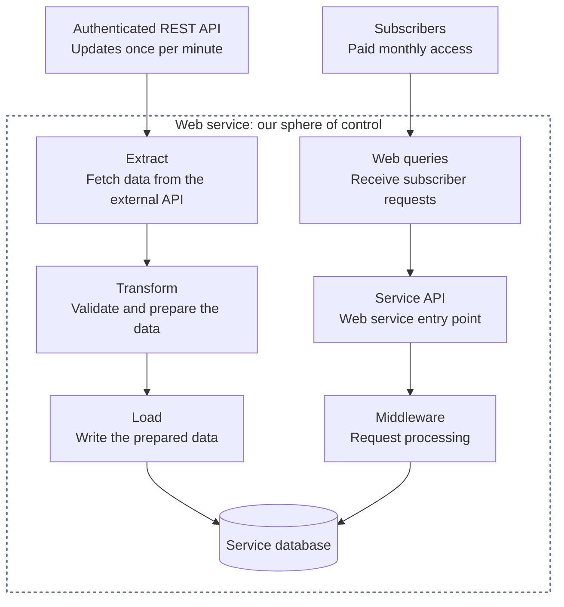

# Web-Based ETL System Design

A practical guide to turning external API data into a service people pay a monthly subscription to use.

## Table of contents

- [1. Quick Problem Description](#1-quick-problem-description)
- [2. Observability/Monitoring/Alerting](#2-observabilitymonitoringalerting)
- [3. System Components](#3-system-components)
  - [3.1 Data Ingest](#31-data-ingest)
    - [3.1.1 External Credentials Vault/Storage](#311-external-credentials-vaultstorage)
    - [3.1.2 Resilient Reader Fleet](#312-resilient-reader-fleet)
    - [3.1.3 Resilient Message Queue](#313-resilient-message-queue)
    - [3.1.4 Resilient DB Writer](#314-resilient-db-writer)
    - [3.1.5 Monitoring/Alerting](#315-monitoringalerting)
- [License](#license)

## 1. Quick Problem Description

An authenticated REST API publishes data once per minute. Our service fetches it, adds value, and makes it available to paying subscribers. The ETL pipeline **extracts** (fetches), **transforms** (prepares), and **loads** (stores) the data; subscriber requests use our API to access the results.

The dotted box marks our sphere of control; the provider and subscribers are outside it. Arrows show the data and request paths. The API and middleware boxes show responsibilities; middleware typically runs before an endpoint handler and may also process its response.

## 2. Observability/Monitoring/Alerting

Design [monitoring and alerting](https://sre.google/sre-book/monitoring-distributed-systems/) from the start. The owner should learn about problems **no later than customers do**. At every layer, ask what can break, how we'll detect it, what the system should do, and when to notify the owner. A dashboard alone won't wake anyone up. Every component in section 3 closes with **Monitoring/Alerting**, covering what to watch and when to act as we design that component.

**Silence can be its own problem.** Send recurring test alerts through production detection, routing, and delivery; record arrival at the destination before filtering them out of routine human notifications. If that heartbeat stops, an independent watchdog must raise its **own alert**, potentially **out of band (OOB)** through a channel that doesn't depend on the primary alerting system. Occasionally test actual owner notifications too.

## 3. System Components

### 3.1 Data Ingest

Move source updates through readers and a message queue into the database.

#### 3.1.1 External Credentials Vault/Storage

A prototype may start with a hard-coded credential or a manually configured environment variable. For production, use an access-controlled [secrets store](https://cheatsheetseries.owasp.org/cheatsheets/Secrets_Management_Cheat_Sheet.html) with limited reader access and a plan for provider-supported rotation and revocation. A stolen API key or bearer token may let someone act as the customer within its permissions. Environment variables can still deliver secrets at runtime; the store manages their access and lifecycle. Keep secret values out of code, images, browser bundles, and logs, and plan for vault outages.

#### 3.1.2 Resilient Reader Fleet

Read each expected source update more than once with readers spread across [independent failure domains](https://docs.aws.amazon.com/whitepapers/latest/aws-fault-isolation-boundaries/availability-zones.html)—preferably separate availability zones (AZs), or separate regions when regional outages are in scope. Two readers on the same host can fail together; the aim is for a hypervisor or local network-link failure to leave another reader collecting. Budget those redundant calls against the provider's shared rate limits, and handle duplicate or out-of-order updates safely downstream.

#### 3.1.3 Resilient Message Queue

Buffer fetched updates and provide a reliable handoff between readers and database writers.

#### 3.1.4 Resilient DB Writer

Consume queued updates, prepare them for storage, and write them safely even when a message is retried.

#### 3.1.5 Monitoring/Alerting

**Credentials store:** Watch failed or slow secret retrievals, denied or unexpected access, credential expiry where applicable, and failed rotations. Distinguish vault failures from upstream authentication errors; a healthy reader can still be locked out. Alert on suspected misuse and access failures that threaten ingestion, using audit metadata without logging secret values.

**Reader fleet:** Watch missed polls, missing heartbeats, request failures, response times, and source-data age against the provider's expected schedule. A `200 OK` can carry stale data; without reliable source metadata, freshness is unknown. Compare upstream responses with reader progress to separate source trouble from our own failures. A timeout alone doesn't locate the fault; an independent check can help.

**Message queue:** Watch availability, publish/consume errors, backlog size, and the age of the oldest waiting message. A growing backlog can mean writers are blocked or too slow, even when the queue is healthy. Alert before queue delays consume the subscribers' freshness budget.

**DB writer:** Watch failed or slow writes, repeated retries, and time since the last successful database update. Fresh queued data with stalled writes points toward the writer or database. Check that fresh, complete data actually reaches subscribers; a successful write alone doesn't prove that. Run monitoring outside the application's host, notify the owner before freshness or coverage becomes unacceptable, and test that alerts arrive.

## License

[MIT](LICENSE) — use, adapt, and share this guide.
