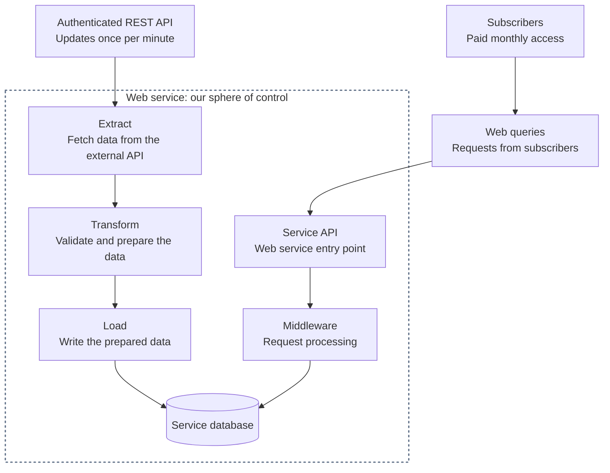

# Web-Based ETL System Design

A practical guide for anyone building a web service that consumes data from an external API, adds value to it, and offers access through a paid monthly subscription.

The goal is to turn source data into useful information or tools that people will pay to keep using. As we work through the system, we'll add design notes at each layer and explain the problems they solve, with practical examples for developers building their first service.

## Table of contents

- [Start with observability](#start-with-observability)
- [The starting picture](#the-starting-picture)
- [First design notes](#first-design-notes)
- [Extract: collecting data that updates every minute](#extract-collecting-data-that-updates-every-minute)
  - [Start with an ingestion worker](#start-with-an-ingestion-worker)
  - [Keep source credentials on the server](#keep-source-credentials-on-the-server)
  - [Plan for slow requests and failed cycles](#plan-for-slow-requests-and-failed-cycles)
  - [Measure freshness through the whole pipeline](#measure-freshness-through-the-whole-pipeline)
  - [Distinguish source problems from reader problems](#distinguish-source-problems-from-reader-problems)
  - [Turn observations into alerts and responses](#turn-observations-into-alerts-and-responses)
  - [Find out whether missed updates can be recovered](#find-out-whether-missed-updates-can-be-recovered)
- [What we'll fill in next](#what-well-fill-in-next)
- [License](#license)

## Start with observability

For a service with paying subscribers, design monitoring and alerting from the beginning. The operating goal is that the owner learns about problems **no later than the customers do**, with enough warning to act wherever possible.

At every layer, answer these questions alongside the happy path:

1. What can fail, become slow, or silently produce the wrong result?
2. What evidence will detect it, including when the component stops reporting altogether?
3. What should the system do automatically, and what should subscribers see?
4. When and how will the owner be notified, and what action should they take?
5. How will we verify recovery and test that the alert actually reaches someone?

Monitoring evaluates the service's behavior. Alerting brings an actionable problem to a person. Metrics show patterns, and structured logs and traces help explain individual failures. A dashboard is useful, but the owner should not have to watch it to discover an outage. Google's [Monitoring Distributed Systems](https://sre.google/sre-book/monitoring-distributed-systems/) explains these foundations.

## The starting picture

Two paths meet at one database. On the left, an ETL pipeline brings data into the system. On the right, subscribers query the web service to access its added value.

The dotted boundary marks the components we build and operate. The provider and subscribers sit outside it. Components inside the boundary may share a host or span several deployments. We cannot repair the provider's service, but we control how our service detects dependency trouble, responds, and communicates its impact.

**Left: bringing data in.** ETL means *Extract, Transform, Load*: fetch data from a source, prepare it for our needs, and write it to our database.

**Right: serving subscribers.** Subscribers send web requests to the service API. The service processes those requests and queries the stored data to deliver useful results. Results travel back to the subscribers; the diagram shows the downward request path to keep the starting picture simple.

The API and middleware boxes show responsibilities. In application code, middleware commonly runs before an endpoint handler and may also process the response on its way out.

This is a starting sketch. The source uses an authenticated REST API and publishes updates once per minute. Its detailed behavior and limits, along with the service's framework, database engine, hosting, and ingestion schedule, still need to be established.

## First design notes

- **Give ingestion and user requests separate responsibilities.** The ETL path prepares stored data; the request path serves it. Keeping those responsibilities clear makes each easier to understand and change. They can still live in the same codebase and deployment.
- **Validate data at both boundaries.** Check incoming source data before storing it, and check user input before using it in a query. We'll define the rules once we know the data and the requests.
- **Make the database's job explicit.** Decide what each record represents, how it is identified, and which rules the database should enforce. Both paths need to agree on those meanings.
- **Define how fresh the data needs to be.** Users querying stored data see what has been ingested so far. The acceptable delay will help us choose when ingestion runs and how to show its status.

## Extract: collecting data that updates every minute

For this example, the external provider publishes updates once per minute. That cadence is a design input, not a guarantee that our subscribers will always see data less than a minute old. We still need to confirm the provider's publication timing, coverage, and availability guarantees.

### Start with an ingestion worker

For a source that expects polling, start with one scheduled server-side worker that collects data independently of subscriber requests. All subscribers can then use the ingested data without each triggering another upstream fetch. The worker can initially share a deployment with the service; keep its collection logic separate so it can move to its own deployment when needed.

One collection cycle may require requests for many assets or multiple pages. A source that updates once per minute does **not** necessarily require just one HTTP request per minute. Work out the total request budget, including retries and authentication, against the provider's limits before choosing a polling schedule.

### Keep source credentials on the server

The worker authenticates to the external provider. Subscribers authenticate to our service; they should never need the provider's credentials.

Keep source credentials out of browser code, the repository, and logs. Supply them through protected server-side configuration or a secrets manager. Establish how credentials expire or rotate and how the worker recovers access, using the provider's documented authentication flow. See [OWASP's secrets management guidance](https://cheatsheetseries.owasp.org/cheatsheets/Secrets_Management_Cheat_Sheet.html).

### Plan for slow requests and failed cycles

- **Set time limits.** Bound individual requests and the whole collection cycle so a stalled source cannot leave a run hanging indefinitely.
- **Control overlapping runs.** If the next scheduled tick arrives while collection is still running, explicitly defer or skip it and record that outcome. Start with one active owner of the schedule; adding service replicas must not accidentally multiply upstream collection.
- **Retry temporary failures within a budget.** Use delayed retries with backoff and a small random variation in timing (jitter). Limit attempts and total elapsed time, and only retry operations that are safe to repeat. Avoid layering independent retry loops. See Microsoft's [Retry pattern](https://learn.microsoft.com/en-us/azure/architecture/patterns/retry).
- **Respect throttling.** An HTTP `429 Too Many Requests` response signals rate limiting and may include `Retry-After`. Honor that delay when supplied; if it exceeds the run's time budget, defer the work. Apply that cooldown to later scheduled cycles too, so the next tick cannot fetch too early. If the header is absent, use the provider's documented policy and bounded backoff. See [RFC 6585, section 4](https://www.rfc-editor.org/rfc/rfc6585#section-4).
- **Handle access failures separately.** An expired credential or denied permission needs the documented renewal flow or operator attention. Repeating the same unauthorized request every few seconds will not fix access.

### Measure freshness through the whole pipeline

Track the source update and our own timestamps, using UTC consistently for times:

| Recorded detail | What it tells us |
| --- | --- |
| Source timestamp or version, when provided | Which source update the data represents. A version identifies an update but may not establish its age. |
| Fetch completion time | When our worker received the data. This alone does not prove that the source data is fresh. |
| Availability time | When that update finished processing and became available to subscriber queries. |

Polling every 60 seconds can add almost another minute of waiting after a source update, even before network, transformation, and database delays. Choose a subscriber-facing freshness target first, then choose and measure a collection schedule that can meet it within the source's limits. A successful HTTP response is not enough: track which expected assets or pages were collected and which updates actually became available.

Define what subscribers see when updates are late or incomplete, and when an operator should be alerted. If the provider supplies no usable source timestamp, report the last successful fetch time as such; do not present it as the age of the underlying data.

### Distinguish source problems from reader problems

"The data stopped updating" is a symptom. It does not tell us whether the provider stopped publishing, the network failed, our reader crashed, or a later processing stage stalled. Collect evidence on **both sides of the fetch** before assigning a cause.

The reader should report scheduled starts, actual starts, progress, request attempts, response outcomes, and cycle completion. Separately, record what the upstream response tells us: status, duration, source publication timestamp or version, and expected coverage. Keep a fetch that completed, a usable new source update, and an update made available to subscribers as distinct outcomes. A `200 OK` response can contain yesterday's data.

| Observation | What it tells us | What to check or do next |
| --- | --- | --- |
| No scheduled run starts, or the reader stops reporting | Our reader, scheduler, host, or telemetry path needs investigation. This is not evidence that the provider is down. | An independent watchdog detects the missing start or heartbeat. Check the host, scheduler, and last recorded progress. |
| A request is attempted but fails with a DNS, connection, TLS, or timeout error | The dependency is unreachable from this reader. The fault could be in our network or client, the route, or the provider. | Keep the error category and request timing. Compare with a controlled probe from another location and the provider's status information; retain an unknown cause until evidence narrows it down. |
| A response returns an upstream `5xx` error | We received an error from the upstream service or its gateway. Our reader can still be functioning correctly. | Record the status and any safe provider request ID; retry within budget and investigate the dependency. |
| Responses arrive, but requests or complete collection cycles take too long | Collection is slow. Individual request latency, scheduling delay, local processing, and total cycle duration help locate the delay. | Compare each duration with its budget. Cancel stalled work, prevent overlapping runs, and distinguish time waiting on the source from time spent inside the reader. |
| Responses return `401`, `403`, or `429` | Access or quota is failing. That may involve our credentials, permissions, or request volume; do not label it a general provider outage. | Follow the documented authentication flow or throttling cooldown, and notify the owner when intervention is needed. |
| Responses return `200`, but the source publication timestamp is too old or a documented publication sequence stops advancing | The returned source data is stale, even though transport is working. This depends on knowing what that timestamp or sequence means. | Compare with the provider's expected publication schedule. Keep the stale status visible and investigate the source's data freshness. |
| The reader received fresh source data, but no usable extraction completes or subscribers still see an older update | Evidence points to our reader or a later processing or serving stage. | Compare the last observed source update with the last accepted, processed, and served updates to locate where progress stopped. |

A second probe is supporting evidence, not proof of root cause: different locations can use different network paths or caches. Keep diagnostic requests within the provider's limits, protect their credentials, and prefer observing normal collection traffic before adding more traffic.

For stale-data detection, use a timestamp tied to the data's publication, with documented semantics. An HTTP response date or a successful fetch time does not establish the age of the data. Unchanged values alone do not prove staleness: sometimes the correct value has not changed. Without a usable source timestamp or a documented update signal, source freshness is **unknown**, not healthy.

Evaluate freshness only when updates are expected, accounting for documented publication windows and delays. Check clock synchronization and flag implausible future timestamps rather than letting a negative age appear healthy. Track missing assets or pages as well as age; an average across the dataset can hide one important asset that stopped updating.

### Turn observations into alerts and responses

**Starting approach — RECOMMENDED:** instrument the reader and use an independent monitor outside its application host to evaluate progress and deliver alerts. The reader cannot reliably report its own host's disappearance. Also check the service from a subscriber's perspective, including the freshness and coverage of the data it actually serves; a healthy process or HTTP health endpoint is not enough.

Useful signals include request counts and outcomes, request and cycle durations, scheduling delay, last progress, last complete usable extraction, observed source age, and missing expected coverage. Keep source observations separate from accepted data and subscriber-visible progress. Distinguish a missing measurement from a measured zero or a healthy result. [Prometheus's instrumentation guidance](https://prometheus.io/docs/practices/instrumentation/) describes monitoring requests and processing stages.

Choose alert thresholds from the subscriber's freshness requirement and the collection schedule. An early-warning threshold must leave room for the monitoring check interval, any evaluation delay, and notification delivery **before** the customer-facing limit is crossed. Allow additional time if the goal is to fix the problem before that limit. A threshold set at the customer-facing limit is already too late for early warning.

For example, suppose a product allows source data to be at most **180 seconds old**. An alert triggered at **120 seconds**, checked every **15 seconds**, with up to **15 seconds** for notification delivery could reach the owner at age **150 seconds**, leaving 30 seconds before the limit. This assumes no additional evaluation delay. These are illustrative numbers, not selected production thresholds; the actual target, timing budgets, and delivery behavior must be agreed and tested.

Configure the response together with the alert:

- **Respond automatically.** Use the bounded retry and cooldown rules above. Preserve the last known good data and its original source timestamp. Do not let a successful stale fetch reset the freshness clock. Label delayed or incomplete data clearly; if old data is no longer suitable for the feature, make that feature temporarily unavailable with an explanation.
- **Notify for impact or imminent impact.** Keep individual failed attempts as diagnostic evidence when recovery fits within the budget. Notify promptly for failures requiring intervention, such as access that cannot be renewed, and for collection, freshness, or coverage failures approaching the customer-facing limit.
- **Send one actionable incident.** Group related failures so a source outage does not produce one page per asset or retry. Include the affected source or pipeline, observed symptom, suspected cause or "unknown," last good source and extraction times, affected coverage, and links to a dashboard and a short response procedure. Exclude credentials, raw response bodies, and credential-bearing URLs.
- **Reach the owner.** Use an interrupting channel the owner will notice for urgent incidents. Configure acknowledgement and escalation or a fallback route for unacknowledged alerts. Record recovery after usable, sufficiently fresh data and required coverage return, rather than after just one successful HTTP response.
- **Monitor the monitoring.** Detect missing telemetry and missed reader check-ins from outside the application host. Use a separate watchdog for the monitor's own check-ins, so silence in the monitoring system is detectable too. Exercise the notification route. A dashboard and alert sender that disappear with the application leave the owner blind. [Prometheus's alerting guidance](https://prometheus.io/docs/practices/alerting/) covers symptom-based alerts and monitoring the alert path.

Before relying on these rules, use a test source or controlled failure injection to simulate an unreachable API, slow responses, stale `200` responses, missing coverage, and access or quota failures. Stop the reader separately, then simulate a missing monitoring check-in. Verify that each case produces the right diagnostic evidence, automatic behavior, customer-facing state, notification, and recovery message. Do not generate these failures by disrupting the real provider.

### Find out whether missed updates can be recovered

Does the endpoint expose only the latest snapshot, or can it return historical updates or changes since a cursor? If it only returns the latest snapshot, a later successful fetch may leave gaps from an outage. Record those gaps rather than claiming retries recovered every missed minute.

When we reach the load stage, we'll define how repeated or out-of-order fetches are handled safely and when a collection checkpoint may advance. Extraction retries and restarts make those downstream rules necessary.

## What we'll fill in next

- How many assets must we collect, and does one request return one asset or a batch?
- What are the provider's request limits, authentication rules, publication timing, and history or replay capabilities?
- How fresh must subscriber-visible data be, and what happens when that target is missed?
- Which alert channel reaches the owner, what is the detection and delivery budget, and what is the fallback if an alert is not acknowledged?
- What does the service do to that data before storing it?
- What value does the service add that makes a monthly subscription worthwhile?
- What questions do users ask, and who is allowed to see which data?
- What happens when an import or a user request fails?

We'll add detail to the diagram and notes as those answers arrive, with the reason for each design decision alongside it.

## License

[MIT](LICENSE) — use, adapt, and share this guide.
